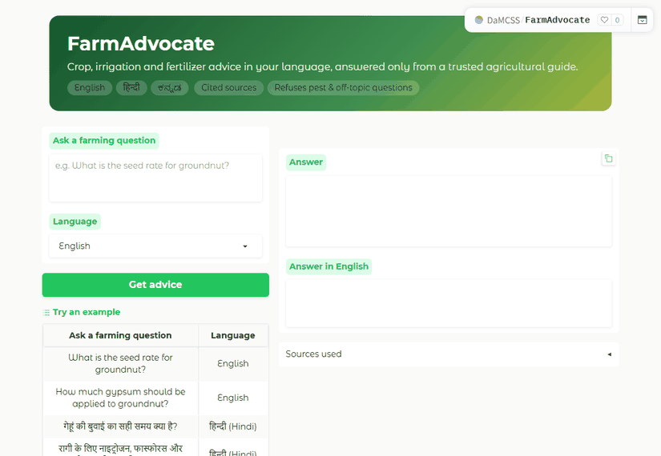
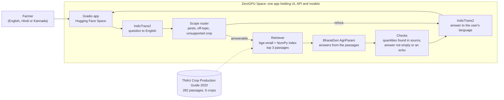

<div align="center">

# FarmAdvocate

**Crop, irrigation and fertilizer advice in English, Hindi and Kannada, answered only from a trusted agricultural guide, with the source page shown.**

[](https://huggingface.co/spaces/DaMCSS/FarmAdvocate)
[](https://github.com/mohanchandrass/FarmAdvocate)




**[Open the live app](https://huggingface.co/spaces/DaMCSS/FarmAdvocate)**
 | **[Case study submission details](#case-study-submission-cs3235-option-2)**

</div>

---

## Why this exists
Most farm guidance is written in long English documents, while many farmers think and ask in Hindi or Kannada. A wrong
fertilizer dose wastes money or harms a crop. FarmAdvocate lets a farmer ask a question in their own language and
returns an answer drawn from retrieved passages of an official guide, with the page it came from. It declines
questions it should not answer (pests, prices, crops outside its sources). It currently covers the Tamil Nadu (TNAU)
Crop Production Guide for six crops, so recommendations are regional and should be confirmed with a local Krishi Vigyan
Kendra (KVK).

## Features
| Feature | What it does |
|---|---|
| Three languages | Ask and read answers in English, Hindi or Kannada; the English answer is always shown alongside |
| Cited answers | Every answer lists the crop, section and printed page of the passages it used |
| Safety checks | Layered: strips prompt-format tokens and detects injection phrasing, refuses pest, off-topic and non-farming questions (cooking, health, lawn) and unsupported crops, checks that quantities in the answer appear in the source, and withholds translations whose numbers changed. Tested on 50 unrelated and injection cases (see the report for limits) |
| Quota fallback | Every question runs the models live. Only if a visitor's free GPU quota is used up, the built-in examples and the 50 evaluation questions fall back to stored outputs of the same system (the API response then has `cached: true`), so a demo does not end in an error. Any other question needs GPU quota |
| API included | The same app exposes a `/ask` endpoint for programmatic use |
| Free to host | Runs on a Hugging Face ZeroGPU Space; no server to manage |

**Try these:** `What is the seed rate for groundnut?` | `गेहूं की बुवाई का सही समय क्या है?` | `ಗೋಧಿ ಬೆಳೆಗೆ ಎಷ್ಟು ಬಾರಿ ನೀರು ಹಾಯಿಸಬೇಕು?` | `How do I control stem borer in rice?` (politely refused)

## How it works

1. **Translate** the question to English (IndicTrans2, Hindi and Kannada only).
2. **Route**: pest, off-topic and unsupported-crop questions get a referral to the local KVK instead of an answer.
3. **Retrieve** the three most similar passages, filtered to the crop mentioned.
4. **Generate** with AgriParam, using its native `<context>` prompt format.
5. **Check** that every quantity in the answer appears in the retrieved text and that the answer is not an echo or a
   "not provided" reply; otherwise show the source passage instead.
6. **Translate back**, withholding any translation whose numbers changed.

## System components
Each part below is small and does one job. File names are relative to the repository root.

| Component | What it is | Why it is there | Key details |
|---|---|---|---|
| **Frontend and API** (`app.py`) | A Gradio app: question box, language picker, answer panel, status badge and a collapsible sources panel | The user interface the brief asks for. The same app exposes `/ask` as an API, plus hidden `/ask_live` and `/closed_book` endpoints used only by the evaluation | Runs on a ZeroGPU Space; a GPU is attached only while a model query runs. English refusals and saved example answers use no GPU |
| **Quota fallback** (`farmadvocate/cache.py`, `data/example_cache.json`) | The system's own stored outputs for the 50 evaluation questions, built by `scripts/build_example_cache.py` | The free GPU quota is tiny, so a demo of the example questions should not end in an error | Used only after a quota error, never first; the API response carries `cached: true`; the evaluation calls `/ask_live`, which never reads stored outputs |
| **Translator** (`farmadvocate/translate.py`) | Two AI4Bharat IndicTrans2 models: Indic to English and English to Indic (Hindi `hin_Deva`, Kannada `kan_Knda`) | AgriParam understands English and Hindi but the guide is English and Kannada is unsupported, so everything is answered in English and translated at the edges | Translates one sentence at a time; spells out ratios (`100:50:50` becomes "100, 50 and 50") because the Kannada model dropped them; converts "1st week" to words; returns a flag if any number changed |
| **Input safety and scope router** (`farmadvocate/rules.py`, word lists in `config.py`) | Rules applied to the question and to its English translation, before any retrieval or generation | Stops the app answering what it should not: prompt-injection attempts, pest and disease advice, prices, weather, cooking, health, gardening and other non-farming questions | Strips the model's prompt tokens and caps length; matches injection phrasing; requires a farming-practice word and no non-farming intent word; whole-word matching, so "tur" does not match "turn". Pattern-based, so a determined attacker can bypass it |
| **Crop detector** (`rules.py`) | Matches crop names and aliases (paddy, finger millet, pigeon pea, and so on) | Restricts retrieval to the right crop, because every crop's chapter has similar headings. Also refuses crops the guide does not index | Treats "millet" as ragi (translators often output it) but refuses pearl millet and sorghum explicitly |
| **Corpus builder** (`scripts/build_corpus.py`) | Extracts the guide's PDF with PyMuPDF and cuts it into passages | Turns a 460-page PDF into searchable units without losing fertilizer tables | Keeps tables as rows; drops pest, disease, weed and variety sections; 180-250 word passages with overlap; each passage is prefixed with crop, system and section; records printed page numbers. Output: `data/chunks.jsonl` (282 passages) |
| **Retriever** (`farmadvocate/retrieve.py`) | `BAAI/bge-small-en-v1.5` embeddings held in a NumPy matrix, searched by cosine similarity | Finds the passages most relevant to the question. No vector database: 282 fixed passages are searched in milliseconds | Top 3 passages; a similarity cutoff of 0.68, set from six dev questions, returns "not found" for weak matches |
| **Generator** (`farmadvocate/generate.py`) | BharatGen AgriParam (2.9B, bf16) | The domain language model named in the brief; produces the answer from the retrieved passages | Uses the model's `<context> ... <user> ... <assistant>` format; greedy decoding for reproducibility; the prompt is trimmed to 1,700 tokens because the model's context is 2,048 |
| **Numeric verifier** (`rules.py`) | A rule check, not a model | A wrong dose is the most harmful error, so quantities in the answer must also appear in the retrieved text | Compares numbers with their units (125 kg is not supported by 125 ml) and N:P:K ratios. It cannot catch a real number used in the wrong place (see the report) |
| **Failed-answer detector** (`rules.py`) | Detects answers that repeat the question, are empty, say the passage does not contain the answer, or share almost no words with the retrieved passages | Replaces a useless or off-script reply with the source passage or a "not found" message | Short answers containing a number, such as `20 kg/ha`, are allowed. A last-resort check also refuses when the passages cover under 20% of the question's topic words |
| **Pipeline** (`farmadvocate/pipeline.py`) | Ties the components together and returns one structured result | One function, `answer(question, language)`, used by the app and by the evaluation | Result has status, answer, English answer, sources, detected crop, timing and the checks' outcomes |
| **Evaluation harness** (`eval/`) | 50 test cases, a runner, reviewer labels and a report | Measures groundedness, factual correctness and domain QA, as the brief requires | Runs against the deployed app; compares AgriParam alone with retrieval; every gold fact is machine-checked against its source page |
| **Deployment** (`scripts/deploy_space.py`) | Creates or updates the Hugging Face Space and its secret | Reproducible hosting | Adds the Space header to this README at deploy time and uploads only the files the app needs |

## Tech stack
| Layer | Choice |
|---|---|
| Domain LLM | [BharatGen AgriParam](https://huggingface.co/bharatgenai/AgriParam), 2.9B, bf16, native context-QA prompt |
| Translation | [AI4Bharat IndicTrans2](https://github.com/AI4Bharat/IndicTrans2), distilled 200M (en to Indic and Indic to en), pinned to the maintainers' `transformers` compatibility fixes |
| Retrieval | `BAAI/bge-small-en-v1.5` embeddings, NumPy cosine search over 282 passages |
| Corpus | [TNAU Crop Production Guide: Agriculture 2020](https://agritech.tnau.ac.in/pdf/AGRICULTURE.pdf): rice, ragi, maize, wheat, redgram, groundnut (crop-protection sections removed) |
| App and hosting | Gradio 5 on Hugging Face ZeroGPU |
| Runtime | Python 3.12, PyTorch 2.8, Transformers 4.53.1 |

## Run it yourself
```bash
git clone https://github.com/mohanchandrass/FarmAdvocate && cd FarmAdvocate
python -m venv .venv && source .venv/bin/activate        # Windows: .venv\Scripts\activate
pip install -r requirements.txt gradio==5.49.1 spaces
huggingface-cli login            # IndicTrans2 is gated: accept its terms on its Hugging Face page first
python app.py                    # needs a GPU for AgriParam (a Colab T4 works)
```
Deploy your own copy to a ZeroGPU Space: `python scripts/deploy_space.py <you>/FarmAdvocate`.
Rebuild the corpus: `python scripts/build_corpus.py path/to/AGRICULTURE.pdf` (needs only PyMuPDF).
Call the API: `Client("DaMCSS/FarmAdvocate").predict("What is the seed rate for groundnut?", "English", api_name="/ask")`.

## Results at a glance
Measured on 50 test cases against the deployed app (full write-up: [`eval/REPORT.md`](eval/REPORT.md)).

| 24 English questions | AgriParam alone | With retrieval (RAG) |
|---|---|---|
| Fully correct | 3 (12%) | **14 (58%)** |
| Correct or partial | 8 (33%) | 17 (71%) |

Retrieval found a passage holding the gold facts for 90% of answerable questions; all 10 should-refuse cases were
declined (by keyword and crop lists); 79% of generated answers were fully supported by their retrieved passages.
Most remaining errors are faithful readings of the wrong passage or an adjacent line, which the number check cannot
catch. See the failure analysis.

Safety: on 50 unrelated-question and prompt-injection cases, the app went from 44 to 50 passing after hardening (5
real failures, mostly crop-flavoured non-farming questions such as "How do I cook rice?"). These cases were written
after the failures were known, so treat 50/50 as optimistic, and the defences are word and pattern rules that a
determined attacker could bypass. The model has no tools or secrets, which limits the damage of a successful
injection to a misleading reply.

> **Honest notes.** Test questions, gold facts and labels were written by Claude (an AI), and no human reviewed them;
> Hindi and Kannada samples are small (8 each). Recommendations are for Tamil Nadu and six crops. New questions need
> GPU time on the free tier: about 2 minutes a day for logged-out visitors (shared by everyone on the same network) and
> 5 minutes for signed-in Hugging Face users, resetting 24 hours after first use. If you see "ZeroGPU quota exceeded"
> for a new question, sign in to Hugging Face; the built-in examples fall back to stored outputs instead of failing.
> The first load after the app has been idle can take several minutes.

## Project layout
```
app.py                  Gradio UI and /ask API
farmadvocate/           pipeline: rules, retrieve, generate, translate, config
scripts/                corpus builder, Space deploy, demo recorder, model checks
data/chunks.jsonl       282 extracted passages (attribution in data/sources.md)
eval/                   50 test cases, runner, labels, raw results, REPORT.md
docs/TRD.md             technical requirements and design decisions
notebooks/              optional Colab runner
```

---

## Case study submission (CS3235, Option 2)

> **This repository is the individual submission for the CS3235 mini-project, Option 2: AI Farmer Advisory Assistant**
> (AI4Bharat and BharatGen sovereign models). Submitted by **Mohan Chandra S S (USN 1RVU23CSE282)**, deadline 6 Nov 2026, CIE3 lab assessment.

**Assignment brief:** *"Provide Indian-language guidance for crop, irrigation and fertilizer queries, backed by curated
agricultural sources. Models/data: BharatGen AgriParam; AI4Bharat IndicTrans2; agricultural advisory documents.
Concepts: Domain LLM, document retrieval, RAG. Evaluation: groundedness, factual correctness, domain QA."*

### Required deliverables
| Requirement | Status | Where |
|---|---|---|
| 30-50 representative test cases | Done: 50 cases (24 en, 8 hi, 8 kn answerable; 10 refusals) | [`eval/test_cases.jsonl`](eval/test_cases.jsonl) |
| Failure analysis | Done: categorised, with causes and fixes | [`eval/REPORT.md`](eval/REPORT.md) |
| Usable frontend | Done: Gradio app, publicly hosted | [Live Space](https://huggingface.co/spaces/DaMCSS/FarmAdvocate) |
| GitHub repository | Done: this repository | [mohanchandrass/FarmAdvocate](https://github.com/mohanchandrass/FarmAdvocate) |
| Models from the brief | Done: BharatGen AgriParam and AI4Bharat IndicTrans2 | [Tech stack](#tech-stack) |

### Assessment rubric mapping
| Rubric criterion | How it is addressed | Evidence |
|---|---|---|
| **Problem definition and relevance** | Language barrier to authoritative farm guidance; scope, users and the Tamil Nadu limitation stated | [Why this exists](#why-this-exists), [TRD section 1](docs/TRD.md) |
| **Model / dataset selection** | The brief's models, with verified specs (size, context limit, licence, gating, language coverage, GPU memory) and rejected alternatives; corpus chosen after testing six candidate sources | [Tech stack](#tech-stack), [TRD sections 3-5](docs/TRD.md) |
| **Working end-to-end application** | Question in three languages to a cited answer, hosted publicly; also exposes an API | [Live Space](https://huggingface.co/spaces/DaMCSS/FarmAdvocate), demo above |
| **GenAI / RAG / agentic integration** | Domain LLM with retrieval-augmented generation; a scope router that decides whether to answer, a crop detector that filters retrieval, a numeric verifier, and a failed-answer detector | [System components](#system-components), `farmadvocate/` |
| **Quantitative testing and error analysis** | 50 cases; AgriParam alone vs RAG comparison; retrieval, groundedness, refusal and per-language metrics; categorised failures | [`eval/REPORT.md`](eval/REPORT.md), raw outputs in `eval/results/` |
| **Demo, documentation and repository** | Animated demo, this README, design document, evaluation report, reproducible scripts | This page, [`docs/TRD.md`](docs/TRD.md) |

### Pre-selection checks the brief asks for
The brief says to confirm checkpoint availability, licensing, language coverage, GPU requirements and suitability
before assigning a model. These were checked against primary sources and recorded in [TRD section 3](docs/TRD.md):
AgriParam is public (not gated), Apache-2.0 per its card, 2.86B parameters, 2,048-token context, English and Hindi only,
about 5.7 GB in bf16; IndicTrans2 distilled checkpoints are MIT and gated, covering all three project languages. Two
compatibility problems were found and worked around (IndicTrans2 on newer `transformers`, and Kannada number loss).

### Models and data used
* **BharatGen AgriParam**: [`bharatgenai/AgriParam`](https://huggingface.co/bharatgenai/AgriParam), Apache-2.0 per the model card
* **AI4Bharat IndicTrans2**: [`ai4bharat/indictrans2-en-indic-dist-200M`](https://huggingface.co/ai4bharat/indictrans2-en-indic-dist-200M) and [`...indic-en-dist-200M`](https://huggingface.co/ai4bharat/indictrans2-indic-en-dist-200M), MIT
* **Agricultural advisory document**: TNAU / Directorate of Agriculture, *Crop Production Guide: Agriculture 2020* (copyright remains with the publishers; extracted passages only, with attribution, for educational use)
* **Supporting component**: `BAAI/bge-small-en-v1.5` embeddings, which the brief does not name but RAG requires

### Evaluation in brief
Groundedness, factual correctness and domain QA were measured as in the table above and in the report: retrieval raises
fully-correct answers from 12% to 58% on the same 24 questions, 31 of 39 generated answers were fully supported by
their sources, and 17 of 40 answerable questions were not fully correct. The report explains each failure and what
would fix it. Labels were produced by an AI and not independently reviewed; this is disclosed in the report.

### Links
| | |
|---|---|
| Live app | https://huggingface.co/spaces/DaMCSS/FarmAdvocate |
| Source code | https://github.com/mohanchandrass/FarmAdvocate |
| Design document (TRD) | [`docs/TRD.md`](docs/TRD.md) |
| Evaluation report | [`eval/REPORT.md`](eval/REPORT.md) |
| Demo | animated GIF at the top of this page |

---
<sub>Licence: code MIT. Model weights keep their own licences. Source guide copyright TNAU / Directorate of Agriculture, Tamil Nadu.</sub>
