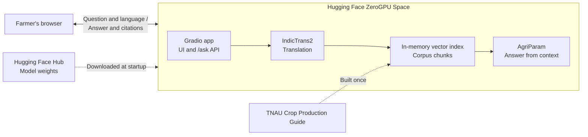

# FarmAdvocate: Technical Requirements Document

**Course:** CS3235 mini-project, Option 2 (AI Farmer Advisory Assistant)
**Author:** Mohan Chandra S S
**Deadline:** 6 Nov 2026, 10:00 (CIE3 lab assessment, individual submission)
**Repo:** https://github.com/mohanchandrass/FarmAdvocate (public, currently empty)
**Status:** v5. Three reviews applied (Appendices A to C). All decisions made (section 12). No application code has been written.

---

## 1. Goal and scope

Build an end-to-end Indian-language assistant that answers crop, irrigation and fertilizer questions from curated agricultural documents, using the models named in the assignment, and measure how well it works.

This is a coursework build. The test for every feature is whether it earns marks under section 2. Anything that doesn't is cut.

### In scope
- Question input and answer output in English, Hindi and Kannada
- RAG over a curated agricultural document, answered by BharatGen AgriParam
- IndicTrans2 translation in both directions
- Source citations and a refusal path for unsupported questions
- Gradio app (frontend and backend together) on a free Hugging Face ZeroGPU Space
- 50 test cases, quantitative evaluation and a failure analysis
- GitHub repository with documentation

### Explicitly out of scope
Local GPU inference, voice input/output, login, databases, chat history or multi-turn conversation, weather or market prices, image-based diagnosis, pest and pesticide advice, React or a frontend build step, a hosted vector database, Docker, CI pipelines, unit test suites, monitoring, rate limiting, mobile apps, fine-tuning.

---

## 2. Assignment requirements and how each is met

| Rubric criterion | How it is met | Evidence |
|---|---|---|
| Problem definition and relevance | Farmers need advice in their own language, while authoritative guides are long, English-only PDFs | README problem statement of 4 sentences: who the farmers are, why language is a barrier, what the app does, and its Tamil Nadu scope |
| Model / dataset selection | The assignment's models (AgriParam, IndicTrans2) and a curated advisory document, with verified specs and rejected alternatives | Sections 3 to 5 |
| Working end-to-end application | Gradio app with hosted models | Space URL, demo recording |
| GenAI / RAG / agentic integration | Retrieval, context-grounded generation, scope router, numeric verifier | Section 6 |
| Quantitative testing and error analysis | 50 cases, closed-book baseline, failure taxonomy | Section 8, `eval/REPORT.md` |
| Demo, documentation and repository | README, this TRD, evaluation report, GitHub repo | Section 11 |

Stated requirements from the brief: **30 to 50 representative test cases, a failure analysis, a usable frontend, and a GitHub repository**. The brief's evaluation terms for this option are **groundedness, factual correctness and domain QA**.

The brief suggests a team of 3 to 4, but the instructor's post says individual submission. This TRD is sized for one person.

---

## 3. What was verified, and what was not

Checks were run on 5 Nov 2026. The implementation should rely on this table, not on assumptions.

### Verified

| Fact | Result | Consequence |
|---|---|---|
| Hugging Face API for these models | `inferenceProviderMapping` is **empty** for AgriParam and all IndicTrans2 models checked | **No API exists. The models must run in our own hosted runtime** (section 9) |
| AgriParam access | `bharatgenai/AgriParam` is not gated; Hub tag says Apache-2.0 | No approval needed. Other listings disagree (one mirror says non-commercial, AIKosh says CC BY 4.0), so the repo states non-commercial coursework use and makes **no claim about commercial reuse** |
| AgriParam size | 2,860,664,832 params, stored F32, 11.44 GB on disk | About 5.72 GB VRAM at bf16 (calculated) |
| AgriParam limits | `max_position_embeddings` = 2048; tags `en`, `hi` only | Context budget required; Kannada must go through translation |
| AgriParam prompt | `<context> ... <user> ... <assistant>`; these tokenize as single special tokens | Native context-QA format, no custom template needed |
| AgriParam code | Tiny random-weight model generated on transformers 4.53.1, torch 2.8.0, Python 3.10, with `use_cache` on and off | Pin these versions. Real weights not yet tested |
| AgriParam memory | Its `forward` computes `lm_head` on **all** positions, then `.float()`. At 1,700 prompt tokens x 256,004 vocab, logits take **1.74 GB** in float32 (0.87 GB in bf16 beforehand) Peak is **estimated** at about 8 GB; measure it at Gate 1. The RTX 4060 (6.4 GB free) would likely fail; a 15 GB T4 and ZeroGPU's 48 GB should be enough |
| AgriParam quality | Self-reported closed-book BhashaBench-Krishi score: 32.18 overall (English 33.10, Hindi 27.97) | Weak without context, which is the core justification for RAG. Use English as the pivot language |
| IndicTrans2 | `ai4bharat/indictrans2-{en-indic,indic-en}-dist-200M`, MIT, 1.10 GB and 0.91 GB, gated `auto` | Needs one click-through per model and an `HF_TOKEN` |
| IndicTransToolkit | v1.1.1 has Linux wheels for Python 3.10 to 3.13, none for Windows. Install and `preprocess_batch` work on Linux | All model code runs on Linux runtimes only |
| IndicTrans2 compatibility | Toolkit issue #29 reports `main` failing on newer transformers (ONNX and `_special_tokens_map` errors). **Maintainer PRs fix this:** `en-indic-dist-200M` `refs/pr/15` is confirmed ("Ready to merge", requires 4.48 or later, tested on CPU and Apple MPS on 4.53.2, 4.57.6 and 5.21.0; not tested on CUDA). `indic-en-dist-200M` `refs/pr/4` has the same title | Load both from their PR revisions, pinned to commit SHAs. The PR says 4.53.2 beam search appended extra tokens to some **batched** outputs, so translate one sentence at a time. Passing `revision="refs/pr/N"` is inferred; test at Gate 1 |
| Gradio and transformers | Gradio 6.31 requires `huggingface-hub>=1.16`; transformers 4.53.1 requires `<1.0`. **Incompatible.** Gradio 5.49.1 allows `>=0.33.5,<2.0` | Pin Gradio **5.49.1**. It has advisories fixed in 6.6/6.7, which is accepted for a coursework demo with no file uploads |
| Hosting | Free accounts cannot create CPU Gradio Spaces, but can host **2 ZeroGPU Gradio Spaces** if the email is verified and the account is older than 30 days | ZeroGPU is the only free option. It requires Gradio, Python 3.10 or 3.12, and torch 2.8 or later |
| ZeroGPU quota | Per visitor per day: 2 min unauthenticated, 5 min free account, 40 min PRO | Evaluation and debugging cannot run there on a free account |
| Inference Endpoints | Dedicated paid GPU at about $0.50/h for a T4 (third-party sources) | Rejected: billing, plus a custom handler for remote code and the toolkit |
| Corpus | TNAU/Directorate of Agriculture *Crop Production Guide: Agriculture 2020*, 460 pages, 4.3 MB | Chosen corpus |
| Corpus extraction | PyMuPDF gives clean text with fertilizer doses intact on sampled pages (e.g. `Apply 10 kg N/ha (22 kg urea)`, `NPK @ 100 : 50 : 50 kg / ha`). Letter-spaced text on 8 of 460 pages | Extraction is viable. Tables still need checking at Gate 2 |
| Page numbering | Printed page = PDF index minus 11 (index 12 is page 1; 28 is 17; 90 is 79) | Hard-code the offset for citations |

### Rejected corpus sources (tested)

| Source | Result |
|---|---|
| TNAU Agritech HTML pages | Mostly navigation, about 100 words per page |
| Vikaspedia | JavaScript-rendered; plain fetch returns 0 to 9 words |
| KAU Package of Practices PDF | Server certificate fails verification |
| ICAR `tech.pdf` | KVK activity report, not advisory content; garbled headers |
| MANAGE handbook (gh-f.org copy) | HTTP 404 |
| KCC-CHAKSHU / KCC transcripts | Unverified quality and access; not worth the time |

### Not yet verified (these become gates in section 10)

1. The IndicTrans2 PR revisions on our exact stack, with CUDA and transformers 4.53.1 (code is gated, so it could not be fetched without a token)
2. AgriParam real weights: answer quality with context, tokens per second
3. The whole app on ZeroGPU, including Gradio 5.49.1 with `spaces`
4. Fertilizer tables across all 6 crops
5. Email verification on the `DaMCSS` account (created 23 Jan 2026, so it passes the 30-day rule)

---

## 4. Model selection

| Role | Model | Runs on | Reason |
|---|---|---|---|
| Answer generation | `bharatgenai/AgriParam` at bf16 | GPU | Named in the brief; agricultural domain LLM |
| Query translation (hi, kn to en) | `ai4bharat/indictrans2-indic-en-dist-200M` | GPU | Named in the brief |
| Answer translation (en to hi, kn) | `ai4bharat/indictrans2-en-indic-dist-200M` | GPU | Named in the brief |
| Retrieval embeddings | `BAAI/bge-small-en-v1.5` | CPU | **Not an LLM.** RAG requires an embedding model and the brief names none, so this is the one necessary addition |

**The models are the ones the brief specifies; no others are being evaluated.** The distilled IndicTrans2 checkpoints are used because they are the smaller official versions.

**Why generate in English for every language.** The corpus is English, AgriParam scores higher in English than in Hindi, and it has no Kannada support. One code path also keeps the evaluation simple.

---

## 5. Corpus

**Source:** *Crop Production Guide: Agriculture 2020*, Directorate of Agriculture, Chennai and Tamil Nadu Agricultural University. https://agritech.tnau.ac.in/pdf/AGRICULTURE.pdf

**Crops included**, using printed page ranges from the table of contents:

| Crop | Printed pages | Aliases for crop detection |
|---|---|---|
| Rice | 1 to 64 | paddy |
| Ragi | 92 to 102 | finger millet, nachni |
| Maize | 103 to 116 | corn, makka |
| Wheat | 122 to 124 | gehun |
| Redgram | 125 to 133 | pigeon pea, arhar, tur, toor |
| Groundnut | 181 to 197 | peanut, moongphali |

That is about 118 pages, or an estimated 200 to 300 chunks.

**Processing (`scripts/build_corpus.py`, run once in a Windows venv; needs only PyMuPDF and writes `data/chunks.jsonl`):**
1. Extract text with PyMuPDF. Repair the letter-spaced lines where possible, or skip them if they fall outside the 6 crops.
2. Tag each page with its crop, and convert to the printed page number using the fixed offset.
3. Detect section headings, and **drop crop protection sections**, because pesticide dosing is out of scope and carries real risk.
4. Drop rice varietal-characteristics tables (roughly printed pages 6 to 16; confirm the boundary), since they would flood retrieval. Variety questions are therefore not tested.
5. Split into chunks of 180 to 250 words with 40 words of overlap, without crossing a section heading.
6. Prefix each chunk: `Crop: Rice | Section: Nutrient Management | ...`. Each crop's sections look nearly identical, so without this prefix retrieval will mix crops. For rice, include the system (such as "Transplanted puddled lowland") in the section, because doses differ by system.
7. Write fields `id, crop, section, page_start, page_end, text`.

**Regional limitation:** recommendations are written for Tamil Nadu. The app must say so with every answer, and the README must list it as a limitation.

**Only if Gate 2 fails:** hand-correct the damaged passages in `data/manual_fixes.jsonl`.

---

## 6. System design

### 6.1 High-level architecture



One Space holds everything: web page, API, models and vector index. There is no separate frontend or backend to deploy, and one `git push` updates it all.

### 6.2 Technology decisions

| Layer | Choice | Why |
|---|---|---|
| Frontend | Gradio Blocks | Named in the brief; about 40 lines of Python, with no separate build |
| Backend | The same Gradio app; endpoint `/ask` is exposed automatically | ZeroGPU only supports Gradio |
| Hosting and compute | ZeroGPU Space | Free GPU; Vercel cannot run these models |
| LLM | AgriParam | Named in the brief |
| Translation | IndicTrans2 | Named in the brief |
| Embeddings | `bge-small-en-v1.5` | Needed for retrieval |
| **Vector store** | **NumPy matrix in the Space's memory, built at startup from `data/chunks.jsonl`** | See below |
| Database, auth, sessions | None | Stateless, one question at a time |

**Why no vector database.** The corpus is 200 to 300 fixed chunks that never change at runtime, so an exact search over a NumPy matrix takes milliseconds, and the search itself is one dot product. Pinecone or Qdrant Cloud would add an account, a key and network latency with no benefit at this size, and FAISS would return the same results as an extra dependency. If asked in a viva: *a vector database solves scale and live updates, and this corpus has neither.*

### 6.3 Backend pipeline

```
Question (en / hi / kn)
   |
   v
[1] Translate to English (IndicTrans2; skipped for en)
   |
   v
[2] Scope router (explicit terms) --- pest or disease, off-topic ---> out_of_scope + referral
   |
   v
[3] Detect crop (alias table) --- crop outside the corpus ---> unsupported_crop + referral
   |
   v
[4] Retrieve top 3 chunks (bge-small cosine, filtered to detected crop)
   |--- best score below threshold ---> not_found + referral
   v
[5] AgriParam answers from context
   |
   v
[6] Numeric verifier: every quantity with a unit must appear in the context
   |--- fails ---> Replace answer with the top source passage, marked "unverified"
   v
[7] Translate answer to the user's language (skipped for en)
   |
   v
Answer + English version + citations + region notice
```

### Step details

**[2] Scope router.** A deterministic keyword rule using `\b` word boundaries on the English query. Terms: `pest, pests, insect, insecticide, pesticide, fungicide, fungus, disease, weevil, borer`, plus a short list of non-agricultural topics. These receive a fixed message pointing to the local KVK or the Kisan Call Centre (1800-180-1551). `spray` and `control` are deliberately excluded, since foliar fertilizer and poor-growth questions are in scope. The router only catches explicitly unsupported domains; **whether an agricultural question is answerable is decided by crop coverage and retrieval confidence in steps 3 and 4**. This is the only "agentic" routing in the design, and it is intentionally small.

**[3] Crop detection.** Case-insensitive alias match using `\b` word boundaries, so that "tur" doesn't match "turn". A detected crop filters retrieval. If no crop is detected, retrieval searches all crops, and the answer states which crop its source covers.

**[4] Retrieval.** Prefix queries with `Represent this sentence for searching relevant passages: `. Embed chunks at startup from `chunks.jsonl`, which avoids committing a binary. The refusal threshold is calibrated on the dev set (section 8), never on the test set. A question naming a crop outside the corpus (such as coconut) must be refused: add those names to a small `out_of_corpus_crops` list in addition to the threshold.

**[5] Generation.**
```text
<context> {chunk 1}\n\n{chunk 2}\n\n{chunk 3} <user> Answer using only the context above. Include exact quantities and units. If the context does not contain the answer, say you do not know.\nQuestion: {question} <assistant>
```
- `do_sample=False`, `repetition_penalty=1.1`, `max_new_tokens=200`, `use_cache=True`, `eos_token_id` and `pad_token_id` set to the tokenizer's `</s>`. Deterministic output makes evaluation reproducible.
- Budget: input is capped at 1,700 tokens so that input plus output stays under the 2,048 limit. If over, drop the lowest-ranked chunk. Digits tokenize one at a time, so count tokens instead of estimating from words.
- Strip anything after a repeated `<user>` marker.

**[6] Numeric verifier** (`rules.py`). A rule check of about 25 lines, not a second language model:
1. Extract numbers attached to a unit (`kg, g, t, q, ha, acre, cm, mm, days, %, litre, l, ml`), and N:P:K-style ratios. Bare numbers such as list markers are ignored.
2. Normalise before comparing: commas and whitespace, and unit variants such as `kg/ha`, `kg / ha` and `kg per hectare`. Ratios must match in full and in order.
3. Require each quantity to appear in the context.

The crop is already enforced by the retrieval filter. A correct number attached to the wrong fertilizer can still pass, so the report lists this as a known limitation, and any such cases are recorded in the failure analysis. Add a same-sentence nutrient rule only if time remains.

On failure, show the top chunk's text labelled "exact answer could not be verified; here is the source passage". A wrong fertilizer quantity is the most harmful failure this system can produce.

**[7] Translation.** Split into sentences with a regex and translate **one sentence at a time** (see the batching note in section 3): `IndicProcessor.preprocess_batch` then `tokenizer` then `generate(num_beams=3, max_length=256)` then `postprocess_batch`. Language codes are `hin_Deva`, `kan_Knda`, `eng_Latn`. The English version is always displayed alongside.

### 6.4 API contract

The pipeline returns one JSON-style dict, which the UI displays and the automatic `/ask` API returns:

```python
# Request
Client("DaMCSS/FarmAdvocate").predict("ಭತ್ತಕ್ಕೆ ಎಷ್ಟು ಯೂರಿಯಾ ಬೇಕು?", "kn", api_name="/ask")

# Response
{
  "status": "verified",          # verified | unverified | out_of_scope | unsupported_crop | not_found
  "answer": "...",               # In the chosen language
  "answer_en": "...",
  "sources": [{ "crop": "Rice", "section": "Nutrient Management", "page": 21, "text": "..." }],
  "seconds": 18.2
}
```

### 6.5 Frontend (`app.py`, Gradio Blocks)

- Language dropdown, question textbox, submit button, 6 clickable example questions using `gr.Examples` without caching
- Output: answer in the chosen language, English version, status badge
- Accordion for sources: crop, section, printed page, passage
- Fixed notice: "Based on TNAU Crop Production Guide 2020 (Tamil Nadu). Confirm with your local KVK."

Gradio already provides the queue display, the sleeping-Space page and quota error messages, so none are built. The app takes no file uploads.

---

## 7. Repository layout

The repository root doubles as the Space root. It sits at `case study/FarmAdvocate/` on Mohan's disk.

```
FarmAdvocate/
├── README.md               # Space YAML header + project docs
├── app.py                  # Gradio UI and /ask API; `import spaces` first; @spaces.GPU
├── requirements.txt        # Pinned; no gradio or spaces (the Space supplies them)
├── .gitignore, .gitattributes
├── farmadvocate/
│   ├── config.py           # Model IDs, revisions, thresholds, languages, crop aliases
│   ├── rules.py            # Router, crop detection, numeric verifier; pure Python
│   ├── translate.py
│   ├── retrieve.py
│   ├── generate.py
│   └── pipeline.py         # answer(question, lang) -> dict
├── scripts/build_corpus.py
├── data/
│   ├── chunks.jsonl
│   └── sources.md          # Attribution
├── eval/
│   ├── dev_cases.jsonl     # 6 cases, threshold tuning
│   ├── test_cases.jsonl    # 50 cases
│   ├── run_eval.py
│   ├── results/            # Raw per-case CSV
│   └── REPORT.md           # Metrics + failure analysis
├── notebooks/colab_runner.ipynb   # Gate 1 checks + evaluation
└── docs/TRD.md
```

Do not commit the source PDF, weights or any image or binary file. Community reports show Hugging Face rejecting pushes containing binaries or files over 10 MiB, and those commits must then be removed from history. Charts in the report are Markdown tables, and the demo video is an external link.

---

## 8. Evaluation plan

### Test set: 50 cases (plus 6 separate dev cases)

| Group | Count | Purpose |
|---|---|---|
| English, answerable | 24 | Core correctness; covers fertilizer, irrigation, seed rate, season and spacing across all 6 crops |
| Hindi, answerable | 8 | Paired with English questions, to isolate translation loss |
| Kannada, answerable | 8 | Same |
| Should refuse | 10 | 4 crops or topics not in the corpus, 3 pest or pesticide, 3 off-topic; across all three languages |

Schema: `{id, lang, question, question_en, type, crop, gold_page, required_facts: [regex], gold_answer, should_refuse}`.

Questions and gold answers are written by reading the guide, with the printed page recorded. Hindi and Kannada questions must not be generated by IndicTrans2, since that would make the test circular. They are drafted separately by Claude (D2), and the report states that no native speaker checked them.

### Metrics

| Metric | Brief term | Definition | Expected |
|---|---|---|---|
| Factual correctness | factual correctness, domain QA | All `required_facts` found in the English answer, with a review column by Claude that overrides the regex | 70% or above |
| Groundedness | groundedness | Label by Claude (fully supported / partly / not supported) on every generated answer against its retrieved chunks, plus the numeric verifier pass rate. **Computed on generated answers only; verifier fallbacks are excluded** | 80% or above |
| Fallback rate | groundedness | Share of answers replaced by the verifier, always reported beside groundedness | Reported |
| Retrieval Hit@3 | supporting | Any top-3 chunk's page range contains `gold_page` | 80% or above |
| Refusal accuracy | supporting | Correct refusal on the 10 negatives; false refusals on the 40 positives | 90% or above |
| Language degradation | domain QA | Factual correctness on paired en vs hi vs kn; share of Hindi and Kannada answers whose digits survive translation | Reported |

The "Expected" column is a planning estimate, not a pass mark. Results are reported honestly even when below it. Median total time per query is logged, with no per-stage breakdown.

**Label credibility.** Report how often Claude's factual-correctness labels agree with the independent regex result on all answerable cases, and list every disagreement. The README states that Claude produced the labels.

**Experimental comparison.** Run the same 24 English questions in three configurations, with the same LLM. The results table is the main result of the report.

| Configuration | Shows |
|---|---|
| A. AgriParam alone, no context | Baseline |
| B. AgriParam + RAG | Whether retrieval improves correctness and groundedness |
| C. AgriParam + RAG + verifier | What the numeric check catches, including false alarms |

B and C come from the same generation run, since C only applies the verifier to B's logged answers, so this adds no GPU time. **Do not claim that RAG or the verifier helps unless the measured results show it**; a small or negative effect is a valid finding. Translation error is measured separately through the paired Hindi and Kannada cases.

**Failure analysis.** Label every failure as one of: retrieval miss, wrong crop, extraction or table damage, generation ignored context, generation invented a number, query mistranslation, answer mistranslation, router false positive, router false negative, verifier false alarm. Report counts and one worked example per common category, with a proposed fix for each.

**Known limits to state in the report.** Test questions were written from the same document as the corpus, so retrieval results may be optimistic. Test questions, translation checks and result labels were produced by Claude, an AI model, and were not checked by a native speaker or independent human reviewer, so the labels may share the system's blind spots. Results apply to Tamil Nadu guidance.

**Where it runs.** On Google Colab's free T4 through `notebooks/colab_runner.ipynb` (Kaggle's T4 as a backup), at bf16 to match the Space. Not on ZeroGPU, because of quota. The estimate is at most 74 generations (24 for configuration A plus up to 50 for the RAG run; refused cases generate nothing) at 15 to 25 seconds each, or about 30 minutes, to be confirmed at Gate 1. The notebook writes CSVs that are then committed.

---

## 9. Runtime and hosting

No Hugging Face API serves these models (section 3), Vercel cannot run them, and the local GPU would likely run out of memory. So each part runs here:

| Runtime | Used for | Why |
|---|---|---|
| **ZeroGPU Space** | The public app: UI, API and all deployed models | Free, public, no server to manage |
| **Colab free T4** | Gate 1 tests and evaluation | ZeroGPU's quota is too small for repeated runs |
| Windows venv | Corpus build and non-model code only | No torch needed locally, and no GPU |

**Colab is manual:** Mohan opens the notebook and clicks Run All; Claude cannot operate it. Free Colab GPU availability is not guaranteed, which is why Kaggle is the backup.

### Local setup (no models)

```powershell
cd "E:\semester 7\WWLLM\case study\FarmAdvocate"
python -m venv .venv
.venv\Scripts\activate
pip install pymupdf
```

### Dependency pins (`requirements.txt`)

```
torch==2.8.0
transformers==4.53.1
accelerate
sentencepiece
numpy==2.2.6
indictranstoolkit==1.1.1
sentence-transformers==5.7.0
```
These were installed together in the spike on Python 3.10, with the CPU build of torch. Gradio is pinned only through `sdk_version` in the README header, because a second pin can conflict with it; the Space provides `spaces` too. In `config.py`, pin AgriParam to a Hub commit and IndicTrans2 to the commits behind `refs/pr/15` (en-indic) and `refs/pr/4` (indic-en), since all three execute remote code and an open PR can change. These pins are a starting point; Gate 1 establishes the working combination.

### Colab cell order

1. Add `HF_TOKEN` to Colab Secrets
2. Clone the repo and `pip install -r requirements.txt`
3. Restart the runtime, because numpy and torch change
4. Run the Gate 1 checks or `eval/run_eval.py`, and download the results

### Space configuration

README header:
```yaml
---
title: FarmAdvocate
sdk: gradio
sdk_version: 5.49.1
python_version: "3.12"
app_file: app.py
license: mit
preload_from_hub:
  - bharatgenai/AgriParam
---
```
Python 3.12 is chosen to match Colab (confirm Colab's version at Gate 1). `preload_from_hub` fetches AgriParam during the build, which should shorten restarts. The docs exclude private repos and don't address gated ones, so IndicTrans2 downloads at startup; startup timeout defaults to 30 minutes.

Code requirements:
- `app.py` starts with `import spaces`, before anything imports torch
- Load models and call `.to("cuda")` **at module level**, as the docs instruct; do not lazy-load
- Load AgriParam with `torch_dtype=torch.bfloat16, trust_remote_code=True`
- Wrap the pipeline in one `@spaces.GPU(duration=60)` call. Inputs and outputs must be plain picklable types

Deployment, once only:
1. Accept the gate on both IndicTrans2 model pages and create a read-only HF token
2. Create the Space, with Gradio SDK and ZeroGPU hardware
3. Add `HF_TOKEN` as a Space secret
4. `git remote add space https://huggingface.co/spaces/DaMCSS/FarmAdvocate`
5. `git push origin main; git push space main`

No GitHub Action; two remotes are enough. Add one README line saying the first load can take several minutes. **Open the Space before any demo so it is awake.**

**If the account is ineligible (D1), in order of preference:**
1. HF PRO at $9/month: hosts ZeroGPU immediately, and 40 min/day also makes Space-based testing practical
2. Run `app.py` from Colab with `share=True`: free, but the temporary URL only lives while the notebook runs, so the submission relies on the recording

---

## 10. Implementation plan

Each gate is a stop-and-decide point.

| # | Task | Done when | Est. |
|---|---|---|---|
| **Gate 0** | Confirm HF account (D1); accept gates; create token | Eligible, or fallback chosen | 10 min |
| **Gate 1** | In Colab: **IndicTrans2 first** (2 GB, highest compatibility risk), testing hi to en, kn to en, en to hi, en to kn, round-trip preservation of agricultural quantities, and 20 repeated calls without errors. Then AgriParam (11.4 GB) with a full 1,700-token context prompt | All pass; sensible answer; peak memory, speed and exact versions recorded. **No app code until this passes** | 1.5 h + download |
| **Gate 2** | `build_corpus.py`; inspect fertilizer passages for all 6 crops | Doses readable in `chunks.jsonl` | 1.5 h |
| **Gate 3** | Minimal Space: load all models and answer one question on ZeroGPU, logged out | Works from the public URL; quota used recorded | 45 min |
| 4 | Pipeline: retrieve, rules, generate, translate | Runs from the Colab notebook in 3 languages | 1.5 h |
| 5 | Gradio UI and `/ask` on the Space | Full flow works from the public URL, in 3 languages | 45 min |
| 6 | Dev cases, 50 test cases | Files complete | 2.5 h |
| 7 | `run_eval.py`, three configurations, labelling by Claude | Metrics and CSVs produced | 2 h |
| 8 | Failure analysis, README, demo recording, final push, submission | Section 11 checklist complete | 1.5 h |

Work proceeds in small batches, and each gate needs actual evidence (logs or measurements) before the next starts.

**Total: about 12 hours of work plus downloads, with less than 23 hours left.** Start promptly, and aim to finish by the night of 5 Nov so there is a morning buffer. Claude handles the code, test cases and labels; Mohan's manual parts are account steps, Colab runs and the demo recording.

**If time runs short, cut in this order:** the sources accordion, then Kannada test cases (42 cases still meets the 30 to 50 requirement). Do not cut the three-way comparison or the failure analysis, since they carry marks.

**Deadline-day rule:** by 06:00 on 6 Nov, freeze features and run the evaluation with whatever exists. If it can't finish, report metrics on the completed cases and state how many ran.

### Risks

| ID | Risk | Likelihood | Response |
|---|---|---|---|
| R1 | IndicTrans2 PR revisions fail on our stack, or the PRs change | Low to medium | Discovered at Gate 1 for the cost of 2 GB. Establish a working combination in this order: PR revisions on 4.53.1; PR revisions on 4.57.6 (retest AgriParam, whose code uses legacy tuple caches); `main` on 4.38.2. Do not patch library internals unless all three fail |
| R2 | AgriParam answers poorly even with context | Medium | Tighten the prompt, reduce to the top 2 chunks. The verifier falls back to source passages. Report it as a finding. Do not switch model, as the brief names it |
| R3 | HF account email unverified, or Space creation refused | Low | Verify the email; otherwise section 9 fallbacks |
| R4 | ZeroGPU incompatibility with custom code or Gradio 5.49.1 | Low to medium | Discovered at Gate 3. Fallback is the Colab `share=True` link plus recording |
| R5 | PDF tables extract badly | Low to medium | Inspect at Gate 2; `manual_fixes.jsonl` for affected passages |
| R6 | Free Colab GPU unavailable | Low to medium | Kaggle T4 (phone verification needed), same notebook |
| R7 | Visitor quota or sleeping Space during grading | Medium | Demo recording; README note on cold start and on signed-in users getting more quota |
| R8 | Corpus redistribution: the TNAU site says "All Rights Reserved", and no redistribution permission has been found | Low for coursework | Mohan's decision (D3): commit passages with full attribution, and never republish the PDF |

---

## 11. Submission checklist

- [ ] Public GitHub repo with all code and `eval/` results
- [ ] Space URL in the README, tested in a logged-out browser
- [ ] README: 4-sentence problem statement, architecture, models and data with links, setup, results table, limitations, Space and recording links, and an externally hosted screenshot link
- [ ] `eval/test_cases.jsonl` with 50 cases
- [ ] `eval/REPORT.md`: metrics, three-way comparison, failure analysis
- [ ] **Mandatory** demo recording, linked externally, with en, hi, kn and a refusal. It covers a sleeping or out-of-quota Space at grading, so record it on the Space or a Colab `share=True` run, whichever works first
- [ ] Lab submission made before 6 Nov, 10:00

---

## 12. Decisions needed from Mohan

| ID | Decision | Default if no answer |
|---|---|---|
| D1 | Hugging Face account | **Decided:** username `DaMCSS`; eligibility confirmed at Gate 0 |
| D2 | Who checks Hindi and Kannada, and who labels results? | **Decided:** Claude drafts the test questions and labels results; Mohan does no manual testing. The report must state that no native speaker or independent reviewer checked them |
| D3 | How is the guide's text handled? | **Decided:** commit extracted passages with full attribution, for coursework. Never commit the PDF |
| D4 | Are Tamil Nadu recommendations acceptable? | **Default kept:** yes, with a visible regional notice |
| D5 | Is a Vercel frontend needed? | **Decided:** no. Mohan wanted Vercel only if easier, and the Gradio page needs less work and has no quota risk. The Gradio app on the Space is the frontend. Vercel is an optional extra after submission essentials are done |

---

## Appendix A: Independent review outcome

Reviewed by a separate Sonnet agent against v1. Verdict: **GO WITH CHANGES**. Its time estimate was 12.5 hours, or 10.5 with its suggested cuts.

| Finding | Outcome |
|---|---|
| VRAM margin too thin; prefill logits not counted | **Accepted, and worse than reported.** The code confirms 1.74 GB of logits. Moved all inference off the local GPU |
| Verifier false alarms; fallback inflates groundedness | Accepted: unit-bound numbers only; fallbacks excluded and reported separately |
| NLI truncation at 512 tokens; weak on numbers | Resolved by removing NLI, keeping to the brief's models. Groundedness uses manual labels plus the verifier |
| Time estimate optimistic | Accepted: rebudgeted in section 10 |
| Gradio pinned twice | Accepted: `sdk_version` only |
| Alias word boundaries; `spray` in router | Accepted |
| Domain QA mapped to refusal | Accepted: mapped to factual correctness |
| `gold_page` vs chunks undefined | Accepted: page ranges |
| Cold start | Accepted: README line, plus `preload_from_hub` |
| Cut: Evaluation tab, per-stage latency, dev set from 8 to 6, demo cache, standing `manual_fixes.jsonl` | Accepted |
| Cut: digit comparison | Partly accepted: removed from the UI, kept as an evaluation metric, because changed numbers are the key translation risk |
| Cut: 6 crops to 4 | **Rejected.** Page ranges cost little and the test count doesn't change. Wheat matters for Hindi-speaking farmers |

v2 additions after the review: no Hugging Face API exists for these models; issue #29; the Gradio 6 conflict; the 11-page offset; the HF account 404; and the move to hosted-only inference, requested by Mohan.

v3 additions, requested by Mohan: architecture diagram, vector store decision, API contract, and the Vercel frontend. The Sonnet review covered v1 only.

## Appendix B: Second review outcome

An external review of v3, supplied by Mohan. Verdict: **proceed with changes**.

| Finding | Outcome |
|---|---|
| CORS success doesn't prove ZeroGPU quota works from Vercel | Accepted, and made moot by D5: Gradio is now the app, and Vercel is optional |
| IndicTrans2 pin isn't a confirmed working configuration | Accepted, and resolved further: maintainer PRs found. The review's cited September 2026 report could not be located, and the collator issue only affects training, which we don't do |
| Gate 1 must test all translation directions, quantities and repeated calls | Accepted |
| The 8 GB peak is an estimate | Accepted: relabelled, and measured at Gate 1 |
| Licence statements aren't interchangeable; corpus redistribution unclear | Accepted: no commercial claim; D3 now offers the build-at-startup alternative. BharatGen's homepage itself doesn't state licence terms |
| Verifier: unit normalisation, ratios, association checks | Normalisation and ratios accepted. Association made optional after Appendix C, and listed as a known limitation |
| Router shouldn't decide answerability by keywords alone | Accepted: separate `out_of_scope`, `unsupported_crop` and `not_found` outcomes. The review's `control` example wasn't a router term, but it is now explicitly excluded |
| Compare no-RAG, RAG and RAG + verifier | Accepted: adds no GPU time |
| Implementation order and evidence-based gates | Accepted: already matched this order |

## Appendix C: Rubric-fit review outcome

A separate Sonnet agent reviewed v4, acting as the evaluator. Verdict: **would score well if executed; the main risk is the schedule**. Ratings: Model selection, RAG and Testing strong; Problem definition and Docs adequate; Working app at risk until Gate 3 passes. All four hard requirements are met, subject to Gate 3 and the final push.

| Finding | Outcome |
|---|---|
| Recording is the safeguard for a broken Space at grading | Accepted: mandatory in section 11 |
| Schedule has little slack | Accepted: deadline-day rule in section 10 |
| Labels by Claude need some credibility check | Accepted: agreement with regex on all answerable cases, rather than a 10-case sample |
| README content too thin | Accepted: section 11 and the 4-sentence problem statement. The screenshot is linked externally because of the binary rule |
| Cut nutrient-association rule | Accepted: optional, and disclosed as a limitation |
| Stale Vercel and JS references | Removed |
